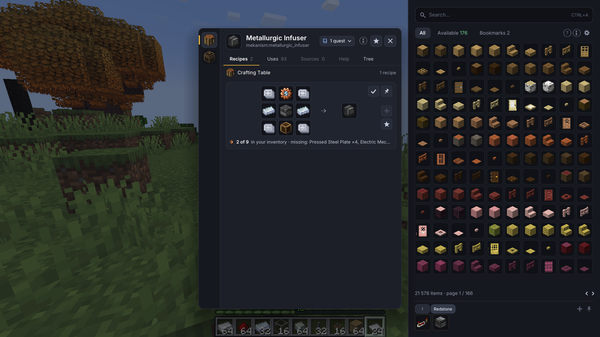

# RYSIndex

*Русская версия ниже: [по-русски](#по-русски).*



**A recipe and item reference.** It shows how to make an item, where to get it and what it is used for. For long chains it builds a crafting tree and plans production. Mod recipes come through JEI, which is already bundled in the jar.

## Features

- an item list with search and filters
- recipes, uses and sources: drops, chests, trading, ores
- a crafting tree that counts what you already have
- a production planner and route comparison
- on-screen goals and bookmarks with folders
- the lens: info about an item, block or mob while holding Alt
- progression stages with locked recipes
- recipe transfer to the crafting table and the AE2 terminal

R opens recipes, U opens uses.

## Requirements

- Minecraft 1.21.1, NeoForge 21.1.x. The server only needs the mod for stages, drop sources and giving items.
- JEI is bundled in the jar, no other mods required.
- Optional: AE2, Modular Machinery Reborn.
- Languages: English and Russian.

## Download and help

- Download: [CurseForge](https://www.curseforge.com/minecraft/mc-mods/rysindex).
- Help, ideas and questions: [Discord](https://discord.gg/Tqgy7acmyd).
- Bugs: [GitHub Issues](https://github.com/MityaKr/RYSIndex/issues).

## Documentation

- [docs/09-data-formats.md](docs/09-data-formats.md): help pages, stages, item groups, time and energy for the planner, reports.
- [docs/07-layouts.md](docs/07-layouts.md): recipe category layouts in JSON.
- [docs/CHANGELOG.md](docs/CHANGELOG.md): version history.

The documents are in Russian.

## The RYS family

RYSIndex is part of the RYS family of mods: one style, shared themes and settings. Each mod works on its own, and together they complement each other.

- [RYSQuests](https://www.curseforge.com/minecraft/mc-mods/rysquests), a quest book with guides and a shop.
- [RYSMap](https://www.curseforge.com/minecraft/mc-mods/rysmap), a world map and minimap.
- [RYSClaims](https://www.curseforge.com/minecraft/mc-mods/rysclaims), chunk land claims.
- [RYSTeams](https://www.curseforge.com/minecraft/mc-mods/rysteams), player teams with roles and alliances.
- [RYSHelm](https://www.curseforge.com/minecraft/mc-mods/ryshelm), the Server window for admins.

## Building from source

You need Java 21. The build takes the family's shared code from the [RYSCore](https://github.com/MityaKr/RYSCore) repository, which must sit next to this one and be published to its local `repo/` folder first:

```
git clone https://github.com/MityaKr/RYSCore
git clone https://github.com/MityaKr/RYSIndex
cd RYSCore && ./gradlew publish
cd ../RYSIndex && ./gradlew build
```

The jar is in `neoforge/build/libs`.

## License

The code is under [MPL-2.0](LICENSE). The graphics and the RYS name remain with the author, see [NOTICE.md](NOTICE.md). You can include the mod in any modpack without asking for permission. The bundled JEI is distributed under the MIT license, see [THIRD_PARTY.md](THIRD_PARTY.md).

Author: MityaYS, RepkaWorks.

---

## По-русски

**Справочник рецептов и предметов.** Показывает, как сделать предмет, где его добыть и куда он идёт. Для длинных цепочек строит дерево крафта и считает производство. Рецепты модов берёт через JEI, он уже вложен в jar.

### Возможности

- список предметов с поиском и фильтрами
- рецепты, использования и источники: добыча, сундуки, торговля, руды
- дерево крафта с учётом того, что уже есть
- планировщик производства и сравнение маршрутов
- цели на экране и закладки с папками
- линза: сведения о предмете, блоке или мобе по Alt
- стадии прогрессии с замком на рецептах
- перенос рецепта в верстак и в терминал AE2

R открывает рецепты, U использования.

### Требования

- Minecraft 1.21.1, NeoForge 21.1.x. Серверу мод нужен только для стадий, источников добычи и выдачи предметов.
- JEI вложен в jar, других модов не требует.
- По желанию: AE2, Modular Machinery Reborn.
- Языки: русский и английский.

### Скачать и спросить

- Скачать: [CurseForge](https://www.curseforge.com/minecraft/mc-mods/rysindex).
- Помощь, идеи и вопросы: [Discord](https://discord.gg/Tqgy7acmyd).
- Баги: [GitHub Issues](https://github.com/MityaKr/RYSIndex/issues).

### Документация

- [docs/09-data-formats.md](docs/09-data-formats.md): страницы справки, стадии, группы предметов, время и энергия для планировщика, отчёты.
- [docs/07-layouts.md](docs/07-layouts.md): раскладки категорий рецептов в JSON.
- [docs/CHANGELOG.md](docs/CHANGELOG.md): история версий.

### Семья RYS

RYSIndex входит в семью модов RYS: один стиль, общие темы и настройки. Каждый мод работает сам по себе, а вместе они дополняют друг друга.

- [RYSQuests](https://www.curseforge.com/minecraft/mc-mods/rysquests), книга квестов с гайдами и магазином.
- [RYSMap](https://www.curseforge.com/minecraft/mc-mods/rysmap), карта мира и миникарта.
- [RYSClaims](https://www.curseforge.com/minecraft/mc-mods/rysclaims), приват земли по чанкам.
- [RYSTeams](https://www.curseforge.com/minecraft/mc-mods/rysteams), команды игроков с ролями и союзами.
- [RYSHelm](https://www.curseforge.com/minecraft/mc-mods/ryshelm), окно «Сервер» для администраторов.

### Сборка из исходников

Нужна Java 21. Общий код семьи сборка берёт из репозитория [RYSCore](https://github.com/MityaKr/RYSCore): он должен лежать рядом с этим и сначала выложиться в свою папку `repo/` командой `gradlew publish` (команды выше). Готовый jar лежит в `neoforge/build/libs`.

### Лицензия

Код под [MPL-2.0](LICENSE), графика и имя RYS остаются за автором, подробности в [NOTICE.md](NOTICE.md). Мод можно включать в любую сборку без отдельного разрешения. Вложенный JEI распространяется по лицензии MIT, подробности в [THIRD_PARTY.md](THIRD_PARTY.md).

Автор: MityaYS, RepkaWorks.
